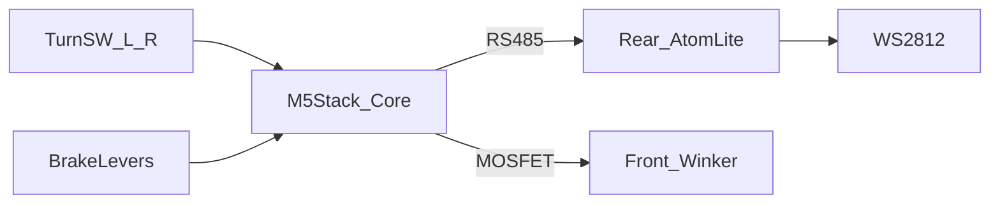
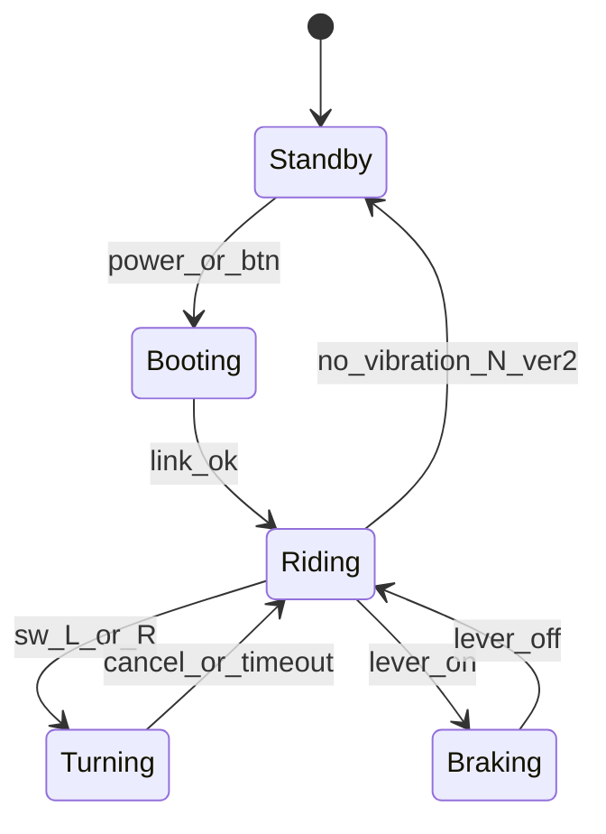

# LaserBlinker（リカンベント）

リカンベント用のウインカー／ブレーキライト。前部をマスタ、後部を灯火スレーブとする。開発は PlatformIO。BLE は使わない。

---

## 当初要件と決定の対応

| 当初 | 決定 |
| --- | --- |
| レーザーで地面に線 | **ver2**。ver1 は後部 WS2812 で左右＋テール |
| 減速加速度でブレーキ灯 | **不採用**。ブレーキレバー直読み（左右 OR） |
| BLE で手元スイッチ | **不採用**。有線 RS-485（論理は UART） |
| 停車中の省電力 | ver2 で本格化。試作・ver1 はまず機能優先 |
| PlatformIO | 採用 |

---

## 構成概要

```text
[USB-C Battery]
    → PDトリガー → 12V ─┬→ メカSW → 前照灯
                        ├→ Core制御 → N-MOSFET → 前ウインカー(12V L/R)
                        └→ Buck → 5V → Core + Proto13.2 (+ GPSは ver2)
                                        │
              GX12-4 (5V, GND, RS-485 A/B) │ ～2m ツイスト＋太電源
                                        ▼
                              [後部: Atom Lite + MAX485]
                                        → WS2812 テープ（後ウインカー＋テール）
                                        → （ver2）レーザー L/R
```



---

## 電源

1. USB-C モバイルバッテリ → PDトリガーで **12V**
2. 同じ 12V から降圧（buck）で **5V**（前後 MCU・WS2812・RS-485）
3. 前照灯・前ウインカーは **12V のまま**（メカSW／MOSFET）

幹線の 5V/GND は信号より **太芯**。電圧降下が厳しい場合は、幹線を 12V＋GND＋A/B にし、**後部で 12V→5V 降圧**する案も可。

スイッチング降圧のロスはおおむね 1 割前後。ヘッドが 5V で足りれば電装を 5V に寄せる選択肢もあるが、既設 12V 前照灯／前ウインカーがあるため **現状は 12V＋buck 5V** を既定とする。

---

## 前部（マスタ）

- **MCU**: M5Stack Core ＋ **Module13.2 Proto（M032）**
- **GPS**: M5Stack 用モジュール入手済み。**実装は ver2**（今はピンを後部通信に優先）
- **入力**
  - ブレーキレバー（左右 OR）→ GPIO
  - 既設ウインカースイッチ L/R → GPIO
- **出力**
  - 前照灯: **メカニカルスイッチ**で 12V（MCU 非経由）
  - 前ウインカー: Core が点滅タイミングを生成 → **N-MOSFET** で 12V 負荷を低側スイッチ
- **幹線**: Proto 上に MAX485 を載せ、GX12-4 へ出す
- Navi 統合はひとまず考えない（UI・ピン競合は後で）

### Proto13.2 の使い方

見た目は穴あき基板だがブレッドボードではない。**はんだ付け＋同梱 HT3.96 ネジ端子**で電線を固定する。Core とは M-Bus スタックで接続。GX12-4 は別途、筐体にパネルマウントして内部を Proto に配線。

### GPS とのピン（ver2 向けメモ）

GPS は UART2（G16/G17＝Port C）が定番。後部リンクは **別 UART**（例: Port A 相当 G32/G33 → MAX485）に分ける。

### ブレーキレバーセンサ（後付け）

加速度推定は使わない。左右は **ダイオード OR で 1 入力**。

推奨順:

1. **ホール＋磁石**（非接触・防水向き）
2. **マイクロSW＋クランプ**（安価・調整しやすい）
3. **リードSW＋磁石**

3D プリント: スプリットクランプ、センサ長穴、ストレインリリーフ。屋外は PETG/ASA。

### 前ウインカー MOSFET（低側スイッチ）

```text
12V+ ── [ランプ] ── Drain
                   MOSFET
                   Source ── GND
Gate ──[100Ω]── Core GPIO
       └──[10k]── GND（プルダウン）
```

ロジックレベル MOSFET（例: IRLZ44N / AO3400 級）。点滅は GPIO の 1–2 Hz トグル。

---

## 前後幹線（2m・リカンベント）

| 項目 | 内容 |
| --- | --- |
| コネクタ | **GX12-4**（自前割当・ラベル必須） |
| ケーブル | ～2m。A/B はツイストペア、5V/GND は太線 |
| 物理層 | **RS-485**（前後に MAX485 等）。論理は UART |
| ボーレート | まず **9600**、安定後に上げる |

Grove 延長の素 UART は 2m 超では非推奨（細い平行線・シールドなし・3.3V 単端）。

### GX12-4 ピン割当（本プロジェクト定義）

| Pin | 信号 |
| --- | --- |
| 1 | 5V |
| 2 | GND |
| 3 | RS-485 A |
| 4 | RS-485 B |

※ GX12 に業界標準ピンはない。他用途ケーブルとの誤挿に注意。A/B が通信しないときは入れ替えて試す。

### プロトコル（案）

- Core → 後部: `TURN=L|R|0`, `BRAKE=0|1` 等（1行テキスト＋checksum）
- 後部 → Core: `ACK` / `FAULT`、ハートビート
- **通信断タイムアウトで後部は全消灯**（フェイルセーフ）
- 点滅タイミングは **Core がマスタ**（前 FET と後部テープを同期）

### 試作時の UART 直結ピン（参考）

| 役割 | Core | Atom Lite |
| --- | --- | --- |
| TX→RX | G17 | G32 |
| RX←TX | G16 | G26 |
| 5V / GND | 共通 | 共通 |

`Serial2.begin(..., 16, 17)` / `Serial1.begin(..., 32, 26)`。信号はクロス、電源はストレート。

---

## 後部（スレーブ）

### 採用: M5Atom Lite（既定）

StampS3 より結線しやすい（Grove・底板ピンヘッダ）。はんだ必須ではない。

| 接続 | 方法 |
| --- | --- |
| 幹線 UART（MAX485 の DI/RO） | Grove（G26/G32）または底板 |
| WS2812 DATA | 底板 GPIO（例: G19） |
| 5V / GND | GX12 → MAX485／Atom |
| 実装 | ユニバーサル基板に Atom＋MAX485＋GX12 をまとめるのが推奨 |

**StampS3** は小型化時の選択肢（ピンヘッダはんだ＋キャリア前提）。

### 後部の役割

- RS-485 経由で TURN／BRAKE を受信
- **WS2812 テープ**で後ウインカー L/R ＋テール（尾灯低輝度／ブレーキ時ハイ）
- ACK／ハートビート返信
- **レーザーは ver2**（FET×2）

### 放熱（WS2812）

アルミチャンネルに密着。常時は低 PWM、ブレーキ時のみ高輝度。プラ筐体への直接貼り付けは避ける。

---

## 状態機械（案）



- Braking: **レバー ON**（IMU 減速推定は使わない）
- ウインカー: 1–2 Hz、タイムアウト消灯、任意ハザード
- standby／振動検知の本格化は **ver2**

---

## 試作（bench / ver0）— ソフトウェア確認

**目的**: 机上でロジックと通信を確認。**すべて 5V**。前後 MCU は **ブレッドボード**。

| 本番 | 試作での代用 |
| --- | --- |
| 12V＋PD＋buck | 5V USB 給電 |
| Proto13.2 | ブレッドボード |
| GX12-4＋2m | 短いジャンパ |
| 前ウインカー 12V＋MOSFET | LED＋抵抗 |
| ブレーキ／ウインカーSW | タクトSW |

### 受け入れテスト

1. ブレーキ SW ON → 後部テープが **赤**
2. ブレーキ OFF → 低輝度尾灯 or 消灯
3. ウインカー L/R → 前部黄 LED 点滅 ＋ 後部端が黄点滅
4. キャンセル → アイドル
5. 通信断 → 後部 **全消灯**
6. （任意）前後点滅同期

通信は最初 **UART 直結**でも可。動いたら MAX485 を挟む。

### 試作 BOM（最小）

| 部品 | 数量 | 備考 |
| --- | --- | --- |
| M5Stack Core | 1 | 済 |
| M5Atom Lite | 1 | 済 |
| ブレッドボード | 1–2 | |
| WS2812 テープ 5V | 短尺 | |
| LED（黄）＋330Ω | 2＋2 | |
| タクトSW | 3 | L / R / ブレーキ |
| MAX485 | 0–2 | 0=UART直結 |
| Dupont・5V USB | 適量 | |

---

## スコープ

| ver0（試作） | ver1 | ver2 |
| --- | --- | --- |
| 机上 5V・ブレッドボード | 車載 12V/5V・Proto・GX12 | GPS |
| LED＋短テープでソフト確認 | MOSFET 前ウインカー・2m RS-485 | レーザー地面ウインカー |
| UART→MAX485 段階確認 | ブレーキセンサ本番 | standby／省電力 |

---

## ソフトウェア

- ファーム 2 本: `Core_front`（マスタ）／`Atom_rear`（スレーブ）
- PlatformIO
- BLE スコープ外

---

## 部品リスト（ver1）

入手済みは「済」。型番は代表例（同等品可）。

### 電源・幹線

| 部品 | 数量 | 備考 |
| --- | --- | --- |
| USB-C モバイルバッテリ | 1 | 既存可。PD対応 |
| USB-C PDトリガー（12V固定） | 1 | 例: 12V/3A 級 |
| DC-DC 降圧 12V→5V | 1 | 連続数A余裕 |
| GX12-4（オス＋メス） | 1組 | Pin1=5V, 2=GND, 3=A, 4=B |
| ツイストペア（A/B） | ～2–3m | |
| 電源線 5V/GND（太芯） | ～2–3m | AWG20–22 目安 |

### 前部

| 部品 | 数量 | 備考 |
| --- | --- | --- |
| M5Stack Core | 1 | 済想定 |
| Module13.2 Proto（M032） | 1 | HT3.96 同梱 |
| MAX485 モジュール | 1 | |
| N-MOSFET（ロジックレベル） | 2 | IRLZ44N / AO3400 級 |
| ゲート抵抗 100–220Ω | 2 | |
| プルダウン 10kΩ | 2 | 推奨 |
| フライホイールダイオード | 2 | 誘導負荷時 |
| ブレーキレバーセンサ | 1–2 | ホール／マイクロSW |
| 信号ダイオード（OR用） | 2 | |
| 既設ウインカーSW・前照灯・メカSW | — | 既存流用 |

### 後部

| 部品 | 数量 | 備考 |
| --- | --- | --- |
| M5Atom Lite | 1 | 底板ピンヘッダ推奨 |
| MAX485 モジュール | 1 | |
| WS2812／SK6812 テープ 5V | 適長 | 30–60 LED/m から |
| アルミチャンネル＋拡散カバー | 適長 | |
| 熱伝導両面テープ | 適量 | |
| ユニバーサル基板 | 1 | Atom＋MAX485 まとめ |
| 電解 470–1000µF（5V） | 1 | テープ近傍 |
| 100nF | 数個 | |

### ver2 追加予定

| 部品 | 備考 |
| --- | --- |
| M5 GPS モジュール | 入手済み |
| レーザーラインダイオード L/R | ＋ MOSFET×2 |
| （任意）StampS3 | 小型化時のみ |
