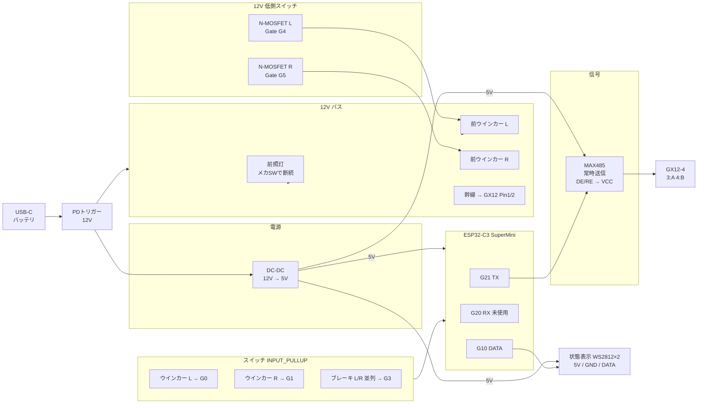

# 前方ユニット回路（現状想定）

幹線は **12V＋RS-485**。前部で PD トリガーの 12V をバスに広げ、降圧 5V で ESP32-C3 / MAX485 / 状態表示を駆動する。
特徴は **12V のとり回し**（前照灯・前ウインカー・後部幹線）と **スイッチが多い**こと。

ピン番号の根拠は `src/front/pins.h` / `src/front/main.cpp`。
端子割当は過去チャットでの決定を反映（ブレーキはマイクロSW、P1 端子は省略可）。

## ブロック図



## 12V の分岐

```text
PDトリガー 12V ─┬─ DC-DC IN+
               └─ 基板 12V バス ─ P2 / P3 / P4 / P5
PDトリガー GND ─┬─ DC-DC IN−
               └─ 基板 GND バス
```

| 行き先 | 制御 | 備考 |
| --- | --- | --- |
| 左ウインカー | MOSFET L（低側） | Drain＝ランプ−、Source＝GND |
| 右ウインカー | MOSFET R（低側） | 同上 |
| 前照灯 | メカSW（MCU 非経由） | ＋線の途中で断続。P4 は 12V / GND パススルー |
| 後部幹線 | 常時供給 | GX12 Pin1/2。後部で自前降圧 |

※ P1（電源入力端子）は省略可。トリガー出力または DC-DC 入力パッドからバスへはんだ付けすればよい。分岐線は 0.5mm² 以上目安。

## GX12-4 ピン割当

| Pin | 信号 |
| --- | --- |
| 1 | 12V+ |
| 2 | GND |
| 3 | RS-485 A |
| 4 | RS-485 B |

※ 後部 `docs/rear-circuit.md` と同じ。A/B が通らないときは入れ替えを試す。
※ A/B は MAX485 モジュールのネジ端子から GX12 へ直結（基板端子は通さない想定）。

## 端子ブロック（推奨）

電力系は **5.08mm**、信号系は **2.54mm**。ピッチを分けて 12V と GPIO の隣接点を防ぐ。
信号端子は全ブロック **1番＝GND**。

### 5.08mm（12V・電力）

| ブロック | 1 | 2 | 備考 |
| --- | --- | --- | --- |
| P2 左ウインカー | 12V | ランプ−（左 Drain） | MOSFET L |
| P3 右ウインカー | 12V | ランプ−（右 Drain） | MOSFET R |
| P4 前照灯 | 12V | GND | メカSWはケーブル途中の＋線 |
| P5 幹線 | 12V | GND | GX12 Pin1/2 |

### 2.54mm（信号）

| ブロック | 1 | 2 | 3 | 備考 |
| --- | --- | --- | --- | --- |
| S1 ウインカーSW | GND | L（G0） | R（G1） | SW 共通＝GND。押下で LOW |
| S2 ブレーキ左 | GND | BRK（G3） | — | マイクロSW。COM–NO |
| S3 ブレーキ右 | GND | BRK（G3） | — | S2 と基板上で G3 並列（OR） |
| S4 状態表示 | GND | DATA（G10） | 5V | WS2812×2 |
| S5 予備（任意） | GND | G6 | G7 | ハザードSW 等 |

## MCU 結線

| 役割 | ピン / 接続 |
| --- | --- |
| 電源 | DC-DC の 5V / GND → SuperMini の 5V / G |
| ウインカーSW L/R | **G0** / **G1**（`INPUT_PULLUP`、押下＝GND） |
| ブレーキSW | **G3**（左右マイクロSW を並列） |
| MOSFET Gate L/R | **G4** / **G5**（HIGH で点灯） |
| WS2812 DATA | **G10**（直列 330Ω 推奨） |
| UART TX | **G21** → MAX485 DI |
| UART RX | **G20**（現状未使用。接続時は RO を分圧） |
| DE / RE | **VCC 固定**（常時送信） |
| 未使用（避ける） | G2 / G8 / G9（起動ストラップ関連） |

## MOSFET（前ウインカー）

```text
12V ── ランプ ── Drain
                   |
                 N-MOSFET（例: IRLZ44N / AO3400）
                   |
                 Source ── GND
Gate ← GPIO（G4 / G5）  ※必要なら Gate 直列 100Ω
```

## ソフト側の注意

- ボーレート 9600（`protocol.h` の `LINK_BAUD`）
- 状態送信周期 `LINK_SEND_MS`（100ms）。`S,turn=…,brake=…`
- 点滅半周期 `BLINK_HALF_MS`（250ms）。ハザードは L+R 同時押し → `turn=B`
- スイッチ・デバウンス `SW_DEBOUNCE_MS`（30ms）
- 書き込み時は **12V 側を外す**（USB 5V と DC-DC 5V の並列を避ける）
- 状態表示 WS2812 近傍に 5V バルク（100µF 程度）推奨
- スイッチ入力（G0/G1/G3）に直列 1kΩ を入れると、外線ノイズと誤ショート時の保護になる
