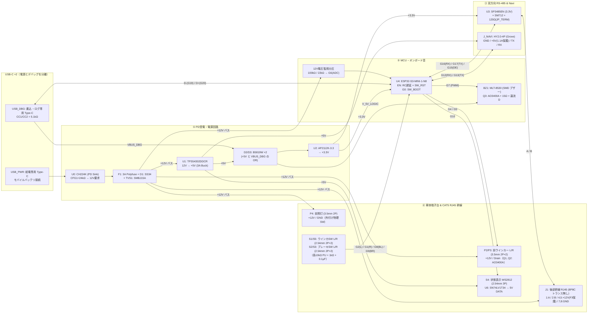

# 前方オールインワン PCB 回路設計書（JLCPCB PCBA 前提）

ユニバーサル基板上で肥大化していたモジュール群（PD トリガー・DC-DC 降圧・MAX485・MCU・TO-220 MOSFET・5.08mm 端子台）を、RJ45 幹線ジャック・ネジ端子台も含めて **1 枚の小型基板（JLCPCB フル PCBA 外注実装：SMD＋スルーホール一括実装、手はんだ不要）** に統合する設計仕様。

- **MCU**: `ESP32-S3-MINI-1-N8`（技適取得済み SMD モジュール、USB-C 直結、ハードウェア UART 3 系統、豊富な GPIO）
- **オンボード 12V PD トリガー**: 給電用 USB-C（`USB_PWR`）＋ `CH224K` を基板に内蔵し、外付けトリガー基板を廃止
- **前照灯の物理スイッチ維持（フェイルセーフ）**: 前照灯は現行どおり MCU 非経由で `+12V` バスから出力。万一 MCU が不動でも、モバイルバッテリーを繋げば `CH224K` 単体で 12V が立ち上がり前照灯は確実に点灯する
- **オンボードウインカー音ブザー**: 昼間でもウインカー動作や後部異常が分かるよう、基板上に 8.5mm 角 SMD 電磁パッシブブザー（`MLT-8530`、80〜85dB）を搭載し PWM 駆動
- **双方向 RS-485 通信**: 後方コア PCB（`docs/rear-pcb-design.md`）と対になる `SP3485EN` 半二重構成とし、後方ユニットからの `ACK`・故障・駐車状態の受信に対応
- **M5Stack Navi 連携端子**: Grove 互換 `HY2.0-4P` コネクタ（`+5V` 給電＋独立 UART）を搭載
- **後方 PCB との部品共通化**: 降圧 IC・LDO・RS-485・レベルシフタ・MOSFET・ダイオードを `docs/rear-pcb-design.md` と同一型番に揃え、部品管理と PCBA コストを最小化

---

## 1. 全体回路図（ブロック＆結線）



---

## 2. 基板上の端子・コネクタ割当と配置イメージ

5.08mm ネジ端子を **3.5mm ピッチ小型ネジ端子台（定格 10A/300V）** に変更して横幅を約 35% 圧縮し、さらに幹線 `P5` に電源と RS-485 `A/B` を 4 極で統合することでケース内の空中配線をなくす。

### 電力・幹線エッジ（3.5mm ピッチ ネジ端子台 ＋ トランス無し RJ45 ジャック）

| 端子記号 | 極数 | Pin 1 | Pin 2 | Pin 3〜8 | 接続先・備考 |
| --- | --- | --- | --- | --- | --- |
| `P2` | 3.5mm 2P | `+12V` | `LAMP_L-` | — | 左前ウインカー（`Q1` Drain 低側スイッチ、`KF350-3.5-2P`） |
| `P4` | 3.5mm 2P | `+12V` | `GND` | — | 前照灯（ケーブル途中に既存の物理スイッチを挿入） |
| `P3` | 3.5mm 2P | `+12V` | `LAMP_R-` | — | 右前ウインカー（`Q2` Drain 低側スイッチ、`KF350-3.5-2P`） |
| `J1` | **RJ45 8P8C** | `RS485_A` (白橙) | `RS485_B` (橙) | `4,5`=`V12_TRUNK` (`F3` 1.5A保護)、`7,8`=`GND`、`3,6`=`NC` | **後方コア PCB `J1` と CAT5e/6 ストレート直結**（万一幹線が短絡しても `F3` のみ遮断し前照灯を維持） |

### 信号端子（2.54mm 端子台 または JST-XH ＋ Grove）

信号端子はすべて **1 番ピン＝`GND`** に統一する。ウインカSWは左右別 2P（`S1`/`S5`）とし、ランプ端子と同じ側に出す。

| 端子記号 | 規格・極数 | Pin 1 | Pin 2 | Pin 3 | Pin 4 | 接続先・備考 |
| --- | --- | --- | --- | --- | --- | --- |
| `S1` | 2.54mm 2P | `GND` | `TURN_L (G2)` | — | — | 左ウインカSW（COM–NO） |
| `S5` | 2.54mm 2P | `GND` | `TURN_R (G1)` | — | — | 右ウインカSW（COM–NO） |
| `S2` | 2.54mm 2P | `GND` | `BRK_L (G8)` | — | — | 左ブレーキ マイクロSW |
| `S3` | 2.54mm 2P | `GND` | `BRK_R (G9)` | — | — | 右ブレーキ マイクロSW |
| `S4` | 2.54mm 3P | `GND` | `LED_DATA_5V` | `+5V` | — | 状態表示 WS2812（ケース上 tape LED 可） |
| `J_NAVI` (`J4`) | **HY2.0-4P** | *(下記参照)* | *(下記参照)* | *(下記参照)* | *(下記参照)* | **M5Stack Navi**（`USB_DBG` 近傍） |

### 基板レイアウト（縦長・ハンドル縦棒）

- **外形目標**: 幅 **≤ ~35 mm** × 高さは配線で決定（2 層、KiCad 生成＋ Freerouting）
- **取付穴**: 当面なし（ハンドル縦棒ケース側で固定。`H1`〜`H4` は回路図に残すが PCB 未配置）
- **生成**: `hardware/front-core/scripts/generate_front_kicad.py` → `scripts/build_pcb.py`
- **成果物**: `hardware/front-core/front-core.kicad_pcb`、`out/3d-top.png` / `out/3d-iso.png`、`fab/`
- **電源ネット名（太線化対象）**: `VBUS_PD` → `V12_FUSED` → `+12V`、`BUCK_SW`、`V5_LOGIC`、`V12_TRUNK`、`VBUS`、`+5V`、`+3V3`

```text
              ← 〜35 mm →
        ┌── 上辺: コネクタ無し（防水）──┐
   左上 │ P2 + S1(TURN_L)  P3 + S5(TURN_R) │ 右上
        │ P4 / S2 / S3 / S4（上部に集約）   │
        │      Buck / LDO / MCU            │
 側面中 │ USB_DBG（左）          J_NAVI 横出し（右）│
        │ U0/F1/D1↔USB_PWR   U3/F3↔J1     │
        └── 下端: USB_PWR | RJ45 ─────────┘
```

配置方針（後部 `rear-core` のゾーニング思想を縦棒向けに適用）:

| ゾーン | 内容 |
| --- | --- |
| 上辺 | **コネクタなし**（防水。状態表示はケース上 tape LED 可） |
| 左上 | `P2` 左ウインカ＋`S1` 左ウインカSW、FET `Q1` 直近 |
| 右上 | `P3` 右ウインカ＋`S5` 右ウインカSW、FET `Q2` 直近 |
| 上部 | その他端子 `P4`/`S2`/`S3`/`S4`（横バー配線が集中） |
| 左側面中段 | `J3` USB_DBG |
| 右側面 | `J4` Navi。横出し `S4B-PH-K`（Grove 2.0mm 互換、ケーブルは右へ） |
| 下端 | `J2` USB_PWR(PD) ＋ `J1` RJ45（ほぼ埋まる） |
| 下端近傍 | `U0`/`F1`/`D1`（12V 受電短経路）、`U3`/`F3`/SM712/`JP_TERM`（RJ45 直近） |
| 中央〜左 | MCU・Buck/LDO。MCU は **90° 回転**しアンテナ先端を **左辺外へ約 5mm はみ出し**（ケースで保護）。`USB_DBG` は左中段で MCU の上 |

> **ファームウェア注意**: 本設計書 §3 と回路図の MCU は **ESP32-S3-MINI-1-N8**。現状の `src/front/pins.h` はまだ **ESP32-C3 SuperMini** 向けのままなので、S3 ピン表への追従は別フェーズ（PCB を正とする）。

---

## 3. ESP32-S3-MINI-1-N8 ピン割当とストラップピン対策

ESP32-C3 と異なり、**ESP32-S3 のストラップピンは `GPIO0`, `GPIO3`, `GPIO45`, `GPIO46`**、ネイティブ USB は **`GPIO19 (D-)` / `GPIO20 (D+)`** になる。特にウインカーSW等を `GPIO0` に繋ぐと「スイッチを入れたまま電源投入した時に書込モードへ落ちて起動しない」ため、`GPIO0` は基板上の `SW_BOOT` 専用に分離している。

| GPIO / 端子 | 信号名 | 接続先・外付け処理 | 備考 |
| --- | --- | --- | --- |
| `EN` | `CHIP_PU` | `10kΩ` → +3.3V、`1µF` → GND、`SW_RST` → GND | 必須の RC リセット遅延回路 |
| `GPIO0` | `BOOT_BTN` | `10kΩ` → +3.3V、`SW_BOOT` → GND | **ストラップピン**（書込モード切替ボタン専用） |
| `GPIO1` | `SW_TURN_R` | `1kΩ` 直列 → `S5-2`（基板側 `10kΩ` → +3.3V + `0.1µF` → GND） | 右ウインカーSW入力（LOW で ON） |
| `GPIO2` | `SW_TURN_L` | `1kΩ` 直列 → `S1-2`（基板側 `10kΩ` → +3.3V + `0.1µF` → GND） | 左ウインカーSW入力（S3 ではストラップ制約なし） |
| `GPIO4` | `MOSFET_TURN_L` | `100Ω` → `Q1 (AO3400A)` Gate（`10kΩ` → GND） | 左前ウインカー駆動（現行 `G4` 互換、HIGH で点灯） |
| `GPIO5` | `MOSFET_TURN_R` | `100Ω` → `Q2 (AO3400A)` Gate（`10kΩ` → GND） | 右前ウインカー駆動（現行 `G5` 互換、HIGH で点灯） |
| `GPIO6` | `VIN_12V_ADC` | `+12V` → `100kΩ` ── `GPIO6` ── `22kΩ` → GND（+ `0.1µF`） | **ADC1_CH5**。12V バス電圧監視（12V 時 約 2.16V） |
| `GPIO7` | `BUZZER_PWM` | `100Ω` → `Q3 (AO3400A)` Gate（`10kΩ` → GND） | オンボード SMD ブザー PWM 駆動 |
| `GPIO8` | `SW_BRAKE_L` | `1kΩ` 直列 → `S2-2`（基板側 `10kΩ` → +3.3V + `0.1µF` → GND） | 左ブレーキSW入力（LOW で ON） |
| `GPIO9` | `SW_BRAKE_R` | `1kΩ` 直列 → `S3-2`（基板側 `10kΩ` → +3.3V + `0.1µF` → GND） | 右ブレーキSW入力（左右独立監視＋ソフト OR） |
| `GPIO10` | `STATUS_WS2812` | `U6 (SN74LV1T34)` の `A` 入力 | 状態表示 WS2812（現行 `G10` 互換） |
| `GPIO11` | `TP_AUX` | テストパッド / 予備ランド（未配線でも可） | 将来のハザード専用ボタン等に利用可 |
| `GPIO12` | `NAVI_RX` | `220Ω` 直列 → `J_NAVI`（Yellow 線：M5 側 TXD）+ `10kΩ` → +3.3V | **UART2 RX**（M5Stack Navi からの受信） |
| `GPIO13` | `NAVI_TX` | `220Ω` 直列 → `J_NAVI`（White 線：M5 側 RXD） | **UART2 TX**（M5Stack Navi への送信） |
| `GPIO15` | `RS485_DE` | `U3 (SP3485)` の `DE`・`/RE` 共通 + **`10kΩ` → GND** | RS-485 送受信切替（HIGH=送信 / LOW=受信待機） |
| `GPIO16` | `LINK_RX` | `U3 (SP3485)` の `RO`（+ `10kΩ` → +3.3V） | **UART1 RX**（後方ユニットからの状態受信） |
| `GPIO17` | `LINK_TX` | `U3 (SP3485)` の `DI` | **UART1 TX**（後方ユニットへの状態送信） |
| `GPIO19` | `USB_D-` | `U7 (USBLC6-2SC6)` 経由 → `USB_DBG` `DN1/DN2` | 内蔵 USB Serial/JTAG（ESD 保護付） |
| `GPIO20` | `USB_D+` | `U7 (USBLC6-2SC6)` 経由 → `USB_DBG` `DP1/DP2` | 内蔵 USB Serial/JTAG（ESD 保護付） |
| `GPIO21` | `STATUS_LED` | `GPIO21` → `1kΩ` → 青色 LED → GND | 基板上の動作確認用 LED（HIGH で点灯） |
| `GPIO3, 45, 46` | *(Strap)* | **未接続（オープン）** | 内部プルダウンのまま触らない（外部プルアップ厳禁） |

---

## 4. ブロック別の回路定数・設計メモ

### ① オンボード USB-PD 12V 受電回路（`USB_PWR` + `CH224K`）
- **給電用 USB-C（`USB_PWR`）とデバッグ用 USB-C（`USB_DBG`）を分離する理由**:
  1 つの USB-C で 12V PD 受電と Mac への USB 通信を兼ねると、`CH224K` の急速充電ネゴシエーション用 `DP/DM` と ESP32 の USB 通信が衝突するほか、Mac に繋いだ瞬間に前照灯やランプへ大電流が流れてポート保護が働く恐れがある。2 口に分けることで、**車載バッテリーを繋いだまま Mac を挿してシリアルログを見る**ことも、**机上で Mac だけを挿して安全にファームを書き込む**こともできる。
- **`CH224K`（ESSOP-10、底面放熱パッド `Pin 0` = `GND`）結線**:
  - `VDD (Pin 1)`: `VBUS_PD` から **`R1 = 1kΩ`（0805、1/8W 以上）** を直列に介して接続し、`VDD`–`GND` 間に **`1µF / 10V`** セラミックコンデンサを置く（`VBUS_PD` 直結は厳禁）。
  - `VBUS (Pin 8)`: `VBUS_PD` から **`R2 = 10kΩ`** を直列に介して接続。
  - `CFG1 (Pin 9)`: **`R_SET = 24kΩ` → `GND`** で **12V 要求**に固定（単一抵抗モードのため `CFG2 (Pin 2)`, `CFG3 (Pin 3)` は未接続オープンにする。なお `56kΩ` にすると 15V になるため必ず `24kΩ` とすること）。
  - `CC1 (Pin 7)`, `CC2 (Pin 6)`, `DP (Pin 4)`, `DM (Pin 5)`: `USB_PWR` の対応ピンへ直結（PD だけでなく QC 対応モバイルバッテリーからも 12V を引き出せる）。
  - `PG (Pin 10)`: オープンドレイン Power Good 出力（12V 確立時に LOW）。`+12V` → `4.7kΩ` → 緑色 LED → `PG` を繋いでおくと、12V ネゴシエーション成功が一目で分かる。
- **12V バス保護と電圧監視**:
  - `VBUS_PD` → ポリスイッチ `F1`（1812 サイズ、保持 3.0A、例: `1812L300/16`）→ ショットキー `D1 (SS34)` → `+12V` バス。
  - `+12V` バスに TVS `SMBJ15A` と入力コンデンサ `22µF / 25V`（1206）× 2。
  - 電圧監視 ADC（`GPIO6`）: `+12V` → `100kΩ` → `GPIO6` → `22kΩ` + `0.1µF` → `GND`。12V 時に約 `2.16V`、万一非 PD の 5V バッテリーが挿さった場合は約 `0.90V` となり、MCU や M5Stack Navi 画面上でバッテリー電圧低下や PD フォールバックを検知できる。

### ② 電源回路（12V → 5V 3A Buck ＋ ダイオード OR ＋ 3.3V LDO）
後方コア PCB（`docs/rear-pcb-design.md`）と完全に同一の回路・部品を使用する。
- **12V → 5V 降圧（`U1: TPS54302DDCR`）**:
  - **`EN (Pin 5)` はオープン（未接続）** とする（`EN` 絶対最大定格 7V のため `+12V` へ接続禁止。内部プルアップ電流源で自動起動）。
  - `L1 = 4.7µH`（飽和 4A 以上）、`BOOT–SW` 間 `0.1µF`、帰還抵抗 `R_FB1 = 75kΩ (1%)` / `R_FB2 = 10kΩ (1%)` で出力約 **`5.07V`**。
  - 出力コンデンサ `22µF / 10V` × 2 + `220µF / 10V` 電解バルク。
- **USB デバッグ給電とのダイオード OR**:
  - `+5V`（Buck 出力）→ `D2 (B5819W)` → `V_5V_LOGIC`
  - `VBUS_DBG`（`USB_DBG` 5V）→ `D3 (B5819W)` → `V_5V_LOGIC`
  - `V_5V_LOGIC` から 3.3V LDO（`U2: AP2112K-3.3TRG1`、入出力 `10µF + 1µF`）とオンボードブザー（`BZ1`）へ給電する。これにより、机上で `USB_DBG` だけを挿しても MCU・RS-485・ブザー鳴動テストがすべて動作し、かつ M5Stack Navi や外部 5V 側へ逆流しない。

### ③ オンボードウインカー音・警告音ブザー回路（`BZ1: MLT-8530`）
- **部品選定**: `MLT-8530`（8.5×8.5×3.3mm SMD 電磁パッシブブザー、定格 3.6V / コイル抵抗 16Ω、共振周波数 2.7kHz、音圧 80〜85dB）。圧電式より小型で低音域の厚みがあり、ウインカーのリレー擬似音に向く。
- **駆動回路**:
  - `V_5V_LOGIC`（約 4.7V）→ 電流制限抵抗 **`R_BZ = 15Ω`（0805、1/4W）** → `BZ1 (+)`。`15Ω` を挟むことで 16Ω コイルへの印加電圧が定格どおり約 `2.4〜3.4V`（ピーク約 95mA）に収まる。
  - `BZ1 (-)` → `Q3 (AO3400A)` Drain（Source = `GND`、Gate ← `100Ω` ← `GPIO7`、Gate–GND 間 `10kΩ`）。
  - **必須の還流ダイオード**: `BZ1 (-)`（アノード）から `BZ1 (+)`（カソード）へ並列にショットキー **`D_BZ (B5819W)`** を接続し、コイル遮断時の逆起電力を吸収する。`R_BZ` 手前の `V_5V_LOGIC` にパスコン `10µF / 10V` を置く。
- **ソフト側の鳴らし方メモ**:
  - **ウインカー音**: 点灯エッジで `2400Hz` を `10ms`、消灯エッジで `1800Hz` を `8ms` だけ鳴らすと機械式ウインカーリレーに近い「カッ・コッ」音になる。騒音下で目立たせたい場合は共振周波数の `2700Hz` で「ピッ・ピッ」（`40ms`）にすると最大音量が出る。
  - **後部異常アラート**: RS-485 で後方ユニットからの応答が途絶えた際に「ピピピッ」と警告音を鳴らせる。

### ④ 双方向 RS-485 通信回路（`U3: SP3485EN-L/TR`）
後方コア PCB と対称の 3.3V 回路とする。
- `VCC` = `+3.3V`（パスコン `0.1µF`）。
- `RO` → `GPIO16`（バス解放時の不定防止に `10kΩ` → `+3.3V` プルアップ）。
- `/RE` と `DE` を結線 → `GPIO15` + `10kΩ` → `GND`（未駆動時は安全に受信待機）。
- `DI` ← `GPIO17`。
- `A` / `B` 間に終端抵抗 `120Ω`（0805）+ ソルダージャンパ `JP_TERM`（前後 1 対 1 の幹線両端にあたるため、双方向通信時は前後ともショート推奨）および RS-485 専用サージ保護 TVS `SM712` を配置し、そのまま `P5` の Pin 3 / Pin 4 へ出す。
- **半二重通信の手順（ファームウェア）**:
  1. 前方マスタは `GPIO15 (DE) = HIGH` にして `S,turn=...,brake=...\n` を送信し、`LinkSerial.flush()` で送信完了を待ってから即座に `GPIO15 = LOW`（受信待機）へ戻す。
  2. 後方スレーブはコマンド受信後、数 ms 以内に `R,ok=1,park=0\n` 等の短いステータス行を返信する。
  3. 100ms 周期で `500ms` 以上返信がなければ、前方は「後部リンク断」と判定してブザーと M5Stack Navi へ通知できる。

### ⑤ 12V 前ウインカー ドライバ＆外線スイッチ保護
- **前ウインカー MOSFET（`Q1, Q2: AO3400A`）**:
  - TO-220 の `IRLZ44N` から SOT-23 の `AO3400A`（30V / 5.7A、$V_{GS}=3.3\text{V}$ で約 $35\text{m}\Omega$）へ小型化する。12V ウインカー（数 W 級）なら発熱は無視できる。
  - 各 MOSFET の Gate に直列 `100Ω` + プルダウン `10kΩ`。長いランプ配線の誘導サージから MOSFET を守るため、各 Drain（アノード）から `+12V`（カソード）へ還流ダイオード `B5819W` を入れる。
- **ハンドル周りスイッチ入力（`S1, S5, S2, S3`）のノイズ・静電気対策**:
  - 車体外へ伸びるスイッチ線はノイズと静電気を拾いやすいため、MCU 内部プルアップだけに頼らず、各入力に **基板側 `10kΩ` → `+3.3V` プルアップ** ＋ **端子との間に直列 `1kΩ`** ＋ **MCU ピン〜GND 間に `0.1µF` セラミックコンデンサ**（ハードウェア RC デバウンス兼 ESD 吸収）を入れる。
- **状態表示 WS2812（`U6: SN74LV1T34DBVR`）**:
  - 後方基板と同じく `VCC = +5V`、`GPIO10` → `A`、`Y` → 直列 `330Ω` → `S4-2` とし、`S4` 直近の `+5V`–`GND` 間に `22µF / 10V` × 2 を配置。

### ⑥ M5Stack Navi インターフェース（`J_NAVI: HY2.0-4P`）
- **電源供給（`+5V_NAVI`）**:
  - `+5V`（3A Buck 出力 `5.07V`）→ 逆流防止ショットキー `D_NAVI (SS34)`（並列にバイパス用ソルダージャンパ `JP_NAVI`）→ ポリスイッチ `F2`（1206 サイズ、保持 1.1A）→ `J_NAVI` の `5V` ピン。
  - `SS34` を挟んでも約 `4.75V` が供給されるため M5Stack（Core / Core2 / CoreS3 等）は安定動作し、かつ M5Stack 側にだけ USB や内蔵バッテリーがある時に前部基板の 5V ラインへ逆流するのを防げる。万一ハンドルまでの Grove ケーブルが噛み込みショートしても `F2` が遮断するため、ウインカーやブレーキ灯は止まらない。
- **UART 通信保護**:
  - `GPIO13 (NAVI_TX)` と `GPIO12 (NAVI_RX)` にそれぞれ **`220Ω` の直列保護抵抗**を入れる（開発中に双方を TX 設定にしても過電流にならず安全）。`GPIO12` にはケーブル未接続時のノイズ防止用に `10kΩ` → `+3.3V` プルアップを置く。
- **【最重要】`HY2.0-4P` のピン番号とケーブル色順の確認**:
  - M5Stack 純正 Grove ケーブルの物理的な並び順は、端から必ず **黒（`GND`）— 赤（`5V`）— 白（M5 側 `RXD`）— 黄（M5 側 `TXD`）** となっている。
  - したがって前部基板側は **黒＝`GND`、赤＝`+5V_NAVI`、白＝`NAVI_TX (G13)`、黄＝`NAVI_RX (G12)`** に接続すると、M5Stack の **Port C（青色 UART ポート）** へストレートケーブルで挿すだけでそのまま送受信が噛み合う。
  - ※ LCSC / EasyEDA の `HY2.0-4P` コネクタ部品は、データシート上 **Pin 1 が黄側・Pin 4 が黒（GND）側** になっているもの（ラッチを上にして正面から見た左端が Pin 1）が多い。回路図からフットプリントへ落とす際は、ピン番号の数字だけで判断せず、**実物コネクタのラッチ（爪）の向きとケーブルの黒・赤の位置を必ず照合**すること。

---

## 5. JLCPCB PCBA 主要部品リスト（LCSC 型番案）

受動部品（抵抗・コンデンサ）は **0603（1608 メトリック）の JLCPCB Basic Parts** で統一し、主要 IC の大半を後方基板（`docs/rear-pcb-design.md`）と共通化している。

| 記号 | 品名・役割 | 型番 | パッケージ | LCSC 品番目安 | 区分・備考 |
| --- | --- | --- | --- | --- | --- |
| `U0` | USB-PD 12V シンク IC | `CH224K` | ESSOP-10 | `C970725` | Extended |
| `U1` | 12V→5V 3A 同期整流 Buck | `TPS54302DDCR` | SOT-23-6 | `C311038` / `C524861` | 後方と共通 |
| `L1` | パワーインダクタ 4.7µH 4A+ | `SRP6540` 等 | SMD 6.5×6.5mm | `C408412` 等 | 後方と共通 |
| `D1, D_NAVI` | 3A ショットキー（逆接・逆流防止） | `SS34` | SMA | `C8678` | **Basic**（後方と共通） |
| `F1` | 12V 入力ポリスイッチ 3A | `1812L300/16` 等 | 1812 | `C70080` 等 | **Basic** / Preferred |
| `F2` | Navi 5V 保護ポリスイッチ 1.1A | `1206L110THWR` 等 | 1206 | `C70059` 等 | **Basic** / Preferred |
| `TVS1` | 12V サージ保護 TVS | `SMBJ15A` | SMB | `C73385` 等 | 後方と共通 |
| `D2, D3, D4〜D6` | 電源 OR / MOSFET・ブザー還流 | `B5819W` | SOD-123 | `C8598` | **Basic**（後方と共通） |
| `U2` | 5V→3.3V 600mA LDO | `AP2112K-3.3TRG1` | SOT-23-5 | `C51118` | 後方と共通（`AMS1117-3.3` `C6186` 可） |
| `U3` | 3.3V RS-485 トランシーバ | `SP3485EN-L/TR` | SOIC-8 | `C9945` | 後方と共通 |
| `TVS2` | RS-485 バス保護 TVS | `SM712` | SOT-23 | `C15919` | **Basic**（後方と共通） |
| `U4` | Wi-Fi/BLE MCU（技適済） | `ESP32-S3-MINI-1-N8` | SMD Module | `C2913206` | Extended |
| `USB_PWR, USB_DBG` | USB Type-C 16P × 2 | `TYPE-C-31-M-12` | SMD | `C165948` | **Basic**（後方と共通） |
| `U7` | USB 2.0 ESD 保護アレイ（`USB_DBG` 用） | `USBLC6-2SC6` | SOT-23-6 | `C7519` | **Basic**（後方と共通） |
| `F3` | 後方 RJ45 幹線 12V 分岐ポリスイッチ 1.5A | `1206L150THWR` 等 | 1206 | `C70062` | **Basic**（幹線短絡時の前照灯保護） |
| `J1` | トランス無し RJ45 ジャック（8P8C） | `R-RJ45R08P-C000` | THT シールド付 | `C386757` | JLCPCB スルーホール実装対応（後方と共通） |
| `U6` | 3.3V→5V 1ch バッファ | `SN74LV1T34DBVR` | SOT-23-5 | `C100022` | 後方と共通 |
| `Q1, Q2, Q3` | ウインカー L/R・ブザー N-MOSFET | `AO3400A` | SOT-23 | `C20917` | **Basic**（後方と共通） |
| `BZ1` | SMD 電磁パッシブブザー 80dB+ | `MLT-8530` | SMD 8.5×8.5mm | `C94599` | Preferred / Extended |
| `SW_RST, SW_BOOT` | SMD タクトスイッチ | `TS-1187A-B-A-B` | SMD 5.1×5.1mm | `C318884` | **Basic**（後方と共通） |
| `P2〜P4` | 3.5mm ネジ端子台（2P×3） | `KF350-3.5-2P` | THT 3.5mm | `C474892` | **JLCPCB スルーホール実装外注** |
| `S2, S3` | 2.54mm ネジ端子台（2P×2） | `XY308-2.54-2P` | THT 2.54mm | `C557685` | **JLCPCB スルーホール実装外注** |
| `S1, S2, S3, S5` | 2.54mm ネジ端子台（2P×4） | `XY308-2.54-2P` | THT 2.54mm | `C557685` | **JLCPCB スルーホール実装外注** |
| `S4` | 2.54mm ネジ端子台（3P） | `XY308-2.54-3P` | THT 2.54mm | `C557686` | **JLCPCB スルーホール実装外注** |
| `J_NAVI` | Grove 互換 4P 横出し | `S4B-PH-K(LF)(SN)` | THT ライトアングル 2.0mm | `C265452` | **JLCPCB スルーホール実装外注** |

> **はんだ付け完全不要のフル実装外注**:
> RJ45 ジャック（`J1`）・ネジ端子台（`P2〜P4`, `S1〜S5`）・Grove コネクタ（`J_NAVI`）すべてに LCSC 在庫品番を設定し `DNP` 解除としているため、JLCPCB の **Standard / Economic PCBA（SMT＋Wave/Hand Soldering）** にそのまま丸投げできる。到着後は LAN ケーブルと Grove ケーブルを挿し、前照灯・ウインカー・スイッチの電線をマイナスドライバーでネジ留めするだけで組み上がる。

---

## 6. 基板レイアウト・ケース設計時の注意点

1. **12V バスのパターン幅**:
   `USB_PWR` → `F1` → `D1` → `P2 / P3 / P4 / P5` および `GND` 本線には、前照灯＋ウインカー＋後方テープの合計電流（最大 2〜3A）が流れる。1oz 銅箔基板の場合、この区間は **パターン幅 `1.5mm〜2.0mm` 以上**（またはポリゴンベタ配線）で太く短く引き回す。
2. **`ESP32-S3-MINI-1` のアンテナ Keepout**:
   モジュール先端の PCB アンテナ部を基板外周エッジに合わせるか、アンテナ周囲 5mm 以内の全層の銅箔（GND ベタ含む）を禁止領域（Keepout）にする。
3. **ブザー音量を外へ逃がすケース構造**:
   `MLT-8530` は**側面放音（Side Sound Port）**タイプのため、放音ポート側をケース壁のスリットまたは **Ø2〜3mm 程度の放音穴**に向け、内側から **防水透音シート（ゴアテックス粘着ベントシール等）** を貼ると、雨水の浸入を防ぎながらクリアなウインカー音を確保できる。
4. **2 つの USB-C ポートの識別**:
   シルク印刷で `USB_PWR` 側に大きく **`12V PD IN (BATTERY)`**、`USB_DBG` 側に **`MCU USB (PC)`** と明記し、可能なら基板の左右別エッジに離して配置すると挿し間違いを防げる（なお回路上は万一逆挿ししても破損しない保護になっている）。
