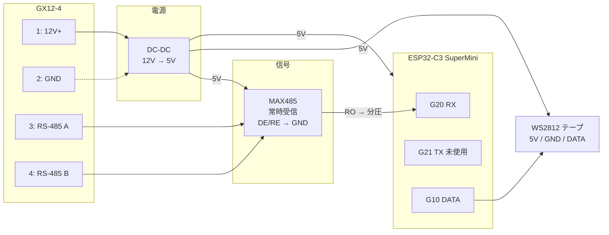

# 後方ユニット回路（現状想定）

幹線は **12V＋RS-485**。後部で降圧して ESP32-C3 と WS2812 を駆動する。
（`PLAN.md` の幹線 5V 案とは異なる実機寄り構成。）

ピン番号の根拠は `src/rear/pins.h` / `src/rear/main.cpp`。

## ブロック図

## GX12-4 ピン割当

| Pin | 信号 |
| --- | --- |
| 1 | 12V+ |
| 2 | GND |
| 3 | RS-485 A |
| 4 | RS-485 B |

※ コネクタに業界標準はない。A/B が通らないときは入れ替えを試す。

## MCU 結線

| 役割 | ピン / 接続 |
| --- | --- |
| 電源 | DC-DC の 5V / GND → SuperMini の 5V / G |
| UART RX | MAX485 RO →（分圧 5→3.3V 推奨）→ **G20** |
| UART TX | **G21** → MAX485 DI（現状未使用・一方向受信） |
| DE / RE | **GND 固定**（常時受信） |
| WS2812 DATA | **G10** |
| デモ切替 | **G9**（BOOT） |
| 状態 LED | **G8**（内蔵青・active LOW） |

## ソフト側の注意

- ボーレート 9600（`protocol.h` の `LINK_BAUD`）
- `LinkSerial.setRxInvert(true)`（MAX485 モジュールの極性差対策）
- 通信断 `FAILSAFE_MS`（500ms）でテープ全消灯
- WS2812 近傍に 5V バルクコンデンサ（470–1000µF）推奨
