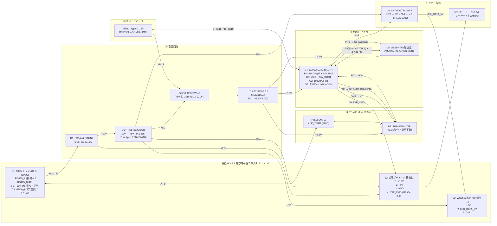

# 後方コア PCB 回路設計書（JLCPCB PCBA 前提）

外部の端子盤（WS2812 テープ、将来の拡張ユニット）を除く中核回路と、前後幹線をつなぐ **トランス無し RJ45 ジャック（CAT5e/6 LAN ケーブル直挿し）** を 1 枚の小型基板に統合する設計仕様。

- **MCU**: `ESP32-C3-MINI-1-N4`（技適取得済み SMD モジュール）
- **拡張ポート `J3`**: `+12V` / `+5V` / `GND` / `EXP_CMD`（GPIO4、3.3V）。レーザー駆動などは別基板に任せ、本基板は電源とコマンドだけ供給
- **モーション検知**: `LIS3DHTR`（3 軸加速度センサ、I2C＋RTC ウェイクアップ割り込み対応）
- **既存ファームウェア互換**: `G8`（状態 LED）、`G9`（BOOT/デモ）、`G10`（WS2812）、`G20/G21`（RS-485）のピン番号を維持し、現行 `src/rear` がそのまま動作する構成

---

## 1. 全体回路図（ブロック＆結線）

---

## 2. ESP32-C3-MINI-1 ピン割当とストラップピン対策

ESP32-C3 は `GPIO2`, `GPIO8`, `GPIO9` が起動モード決定用のストラップピンになっており、特に **`GPIO8` が起動時に LOW だとシリアル書込モードにすら入れない**ため注意が必要。

| GPIO / 端子 | 信号名 | 接続先・外付け処理 | 備考 |
| --- | --- | --- | --- |
| `EN` | `CHIP_PU` | `10kΩ` → +3.3V、`1µF` → GND、`SW_RST` → GND | 必須の RC リセット遅延回路 |
| `GPIO0` | `TP0` | テストパッド（空き・RTC GPIO） | 将来のリードSW等の外部割込にも利用可 |
| `GPIO1` | `IMU_INT1` | `U5 (LIS3DHTR)` の `INT1` ピン | **RTC GPIO**。駐車 Deep Sleep からの振動起床に対応 |
| `GPIO2` | *(Strap)* | **`10kΩ` → +3.3V プルアップ** | ストラップピン（起動時 HIGH 必須） |
| `GPIO3` | `RS485_DE` | `U3 (SP3485)` の `DE`・`/RE` 共通 + **`10kΩ` → GND** | プルダウンにより未制御・現行FWでも自動で常時受信 |
| `GPIO4` | `EXP_CMD` | `J3-4` 直結（3.3V CMOS） | 拡張ユニットへの UART TX / コマンド（115200 想定） |
| `GPIO5` | *(reserved)* | 未接続（NC） | 旧レーザー R 駆動ピン。将来用に空き |
| `GPIO6` | `I2C_SDA` | `U5 (LIS3DHTR)` `SDA` + `4.7kΩ` → +3.3V | 加速度センサ I2C データ |
| `GPIO7` | `I2C_SCL` | `U5 (LIS3DHTR)` `SCL` + `4.7kΩ` → +3.3V | 加速度センサ I2C クロック |
| `GPIO8` | `STATUS_LED` | +3.3V → `1kΩ` → 青色LED → `GPIO8` + **`10kΩ` → +3.3V** | **現行 `PIN_STATUS_LED` 互換** 兼 起動時確実 HIGH ストラップ確保 |
| `GPIO9` | `BOOT_BTN` | `10kΩ` → +3.3V、`SW_BOOT` → GND | **現行 `PIN_DEMO_BTN` 互換** 兼 書込モード切替 |
| `GPIO10` | `WS2812_TX` | `U6 (SN74LV1T34)` の `A` 入力 | **現行 `PIN_WS2812` 互換** |
| `GPIO18` | `USB_D-` | `USB1` の `DN1` / `DN2`（直結、等長配線） | 内蔵 USB Serial/JTAG（書込・ログ出力） |
| `GPIO19` | `USB_D+` | `USB1` の `DP1` / `DP2`（直結、等長配線） | 内蔵 USB Serial/JTAG |
| `GPIO20` | `LINK_RX` | `U3 (SP3485)` の `RO`（+ `10kΩ` → +3.3V） | **現行 `PIN_LINK_RX` 互換**（3.3V 直結） |
| `GPIO21` | `LINK_TX` | `U3 (SP3485)` の `DI` | **現行 `PIN_LINK_TX` 互換**（将来の ACK 返信対応） |

---

## 3. ブロック別の回路定数・設計メモ

### ① 電源回路（12V → 5V 3A Buck ＋ 5V → 3.3V LDO）
- **入力保護**:
  - `J1-1 (+12V_IN)` → ヒューズ（任意: ポリスイッチ 1812 3A）→ ショットキーダイオード `D1 (SS34)` → `+12V`。
  - `+12V` と `GND` 間にサージ吸収 TVS `SMBJ15A`（単方向、カソードが `+12V`）と入力セラミックコンデンサ `22µF / 25V`（1206）× 2 + `0.1µF / 50V`。
- **12V → 5V 降圧（`TPS54302DDCR`, SOT-23-6）**:
  - `VIN (Pin 3)` = `+12V`。
  - `EN (Pin 5)` = **オープン（未接続）**。データシート上 `EN` の絶対最大定格は 7V のため `+12V` へ直接プルアップしてはならない（内部プルアップ電流源によりオープンで自動有効）。
  - `BOOT (Pin 6)` — `SW (Pin 2)` 間に `0.1µF / 25V` セラミックコンデンサ。
  - `SW (Pin 2)` → パワーインダクタ `L1 = 4.7µH`（飽和電流 4A 以上、一体成型 6×6mm 等）→ `+5V`。
  - 出力コンデンサ: `22µF / 10V`（0805 または 1206）× 2〜3 個並列（低 ESR）。さらに `J2`（WS2812 端子）近傍に固体電解またはアルミ電解コンデンサ `100〜470µF / 10V` を配置するとテープ突入電流に強い。
  - 帰還抵抗（$V_{ref} = 0.596\text{V}$）: `+5V` → `R_FB1 (75kΩ 1%)` → `FB (Pin 4)` → `R_FB2 (10kΩ 1%)` → `GND`。
    $$V_{OUT} = 0.596 \times \left(1 + \frac{75}{10}\right) = 5.07\text{V}$$
    （端子盤・テープ配線の電圧降下を見込んで約 5.07V は好都合。どちらも JLCPCB Basic Part 抵抗で揃う。）
- **USB 給電との安全な分離（ダイオード OR）**:
  - `+5V`（Buck 出力）→ `D2 (B5819W)` → `V_5V_LOGIC`
  - `VBUS`（USB Type-C 5V）→ `D3 (B5819W)` → `V_5V_LOGIC`
  - これにより、机上で USB ケーブルだけを挿したときに WS2812 テープ側（`+5V`）へ逆流せず、PC の USB ポートを過電流から保護しつつ MCU・IMU・RS-485 の書き込みと動作確認ができる。
- **5V → 3.3V LDO（`AP2112K-3.3TRG1`、SOT-23-5、600mA）**:
  - `VIN (Pin 1)` = `V_5V_LOGIC`、`EN (Pin 3)` = `V_5V_LOGIC`、`GND (Pin 2)` = `GND`、`VOUT (Pin 5)` = `+3.3V`。
  - 入出力にそれぞれ `1µF` + `10µF` セラミックコンデンサ。`ESP32-C3-MINI-1` の電源ピン直近にも `10µF` + `0.1µF` を配置。

### ② USB Type-C（書込・シリアルモニタ用）
- 16 ピン SMD Type-C コネクタ（`TYPE-C-31-M-12`）。
- **`CC1` と `CC2` にそれぞれ独立して `5.1kΩ` → `GND`** を接続（USB-C to C ケーブルでの認識に必須）。
- `VBUS` に ESD 保護（任意: `USBLC6-2SC6` で VBUS と D+/D- を一括保護すると万全）。

### ③ RS-485 トランシーバ（`SP3485EN-L/TR`、3.3V 動作）
- `VCC (Pin 8)` = `+3.3V`（パスコン `0.1µF`）。3.3V 駆動のため `RO` → `GPIO20` に分圧なしで直結できる。
- `RO (Pin 1)` → `GPIO20`（バス解放時の不定防止に `10kΩ` → `+3.3V` プルアップ）。
- `/RE (Pin 2)` と `DE (Pin 3)` を結線 → `GPIO3` + `10kΩ` → `GND`（LOW = 受信有効、HIGH = 送信有効）。
- `DI (Pin 4)` ← `GPIO21`。
- `A (Pin 6)` / `B (Pin 7)` 間に `120Ω`（0805）+ ソルダージャンパ `JP_TERM`（後部ユニットは幹線終端なので原則ショート）。
- `A`, `B` と `GND` 間に RS-485 専用 TVS `SM712`（SOT-23）を入れて長距離ケーブルの誘導ノイズ・静電気を保護。

### ④ WS2812 レベルシフタ（`SN74LV1T34DBVR`、SOT-23-5）
- `VCC (Pin 5)` = `+5V`（Buck 出力側、パスコン `0.1µF`）、`GND (Pin 3)` = `GND`。
- `A (Pin 2)` ← `GPIO10`（3.3V 入力で確実に High 認識する TTL 互換バッファ。しかも `Ioff` 機能内蔵のため、USB のみ接続して `+5V = 0V` の状態でも MCU から 3.3V を入れて安全かつテープへの回り込みも起きない）。
- `Y (Pin 4)` → 直列ダンピング抵抗 `330Ω` → `J2-2 (LED_DATA_5V)`。

### ⑤ 拡張ポート `J3`（電源＋コマンド渡し）
- コネクタは JST-XH **横出し（`S4B-XH-A`）**。座席もたれ装着時は `J1`/`J2`/`J3`/`J4` を基板下辺に集約し、ケース開口を一方向にして雨水対策する。
- 下辺の並び（左→右）: `J2`（WS2812／5V）→ `J4`（USB）→ `J1`（RJ45）→ `J3`（拡張／12V）。
- 配置ゾーン: 左=`J2`＋レベルシフト＋`C7`、上=`MCU`（アンテナ上向き、USB の上）、右=`RJ45`／RS-485／Buck／`J3`。
- ネジ穴: `H1`（右上）と `H2`（左上）、いずれも M2・GND パッド付き。MCU は USB〜RJ45 間の上辺寄り（12V 幹線用にやや左）、`C7`/`U6` は J2 直上。`F1`/`D1` は J1→J3 の右コリドーに短く置き、`L1`/Buck は J3 内側。
- ピン割り当ては拡張ユニット向け（案 C）:
  | ピン | ネット | 用途 |
  | --- | --- | --- |
  | 1 | `+12V` | レーザー等のパワー（本基板 Buck 前の 12V レール） |
  | 2 | `+5V` | 拡張側ロジック電源（DCDC 不要） |
  | 3 | `GND` | 共通 GND |
  | 4 | `EXP_CMD` | `GPIO4`、**3.3V** UART TX / 単線コマンド（115200 想定） |
- レーザーの ON/OFF・赤/緑組合せ・ブレーキなどは **拡張ユニット側** で実装する。本基板は駆動 MOSFET を持たない。
- `EXP_CMD` は 3.3V 出力のため、拡張 MCU は 3.3V 動作、または 5V 耐圧入力を使うこと。

### ⑥ 3 軸加速度センサ（`LIS3DHTR`、LGA-16 3×3mm）
- `Vdd (Pin 14)`, `Vdd_IO (Pin 1)` = `+3.3V`（パスコン `10µF` + `0.1µF`）。
- `CS (Pin 8)` = `+3.3V`（I2C モード選択）。
- `SDO/SA0 (Pin 7)` = `GND`（I2C アドレス `0x18` に固定）。
- `SDA (Pin 6)` = `GPIO6`（`4.7kΩ` → `+3.3V`）、`SCL (Pin 4)` = `GPIO7`（`4.7kΩ` → `+3.3V`）。
- `INT1 (Pin 11)` = `GPIO1`（モーション検知ウェイクアップ割込）。`INT2 (Pin 9)` = 未接続。
- `GND (Pin 5, 12)` および `RES (Pin 10)` = **`GND` に接続**（`Pin 10` はデータシート指定で GND 必須）。`NC (Pin 2, 3)` および未使用 `ADC1〜3 (Pin 16, 15, 13)` は未接続（オープン）。

---

## 4. JLCPCB PCBA 主要部品リスト（LCSC 型番案）

受動部品（抵抗・積層セラミックコンデンサ）は **0603（1608 メトリック）サイズの JLCPCB Basic Parts** で統一すると、Extended Parts のセットアップ費（1 種類あたり約 $3）を最小限に抑えられる。

| 記号 | 品名・役割 | 型番 | パッケージ | LCSC 品番目安 | 区分目安 |
| --- | --- | --- | --- | --- | --- |
| `J1` | トランス無し RJ45 ジャック（8P8C） | `R-RJ45R08P-C000` 等 | THT 横向きシールド付 | `C386757` / `C2683359` | THT（JLCPCB 実装・手付け両対応） |
| `U1` | 12V→5V 3A 同期整流 Buck | `TPS54302DDCR` | SOT-23-6 | `C311038` / `C524861` | Extended |
| `L1` | パワーインダクタ 4.7µH 4A+ | `SRP6540` / 一体成型品 | SMD 6.5×6.5mm | `C408412` 等 | Basic あり |
| `D1` | 12V 逆接保護ショットキー | `SS34` | SMA | `C8678` | **Basic** |
| `TVS1` | 12V サージ保護 TVS | `SMBJ15A` | SMB | `C73385` 等 | Extended |
| `D2, D3` | 電源 OR（+5V / VBUS） | `B5819W` (1N5819) | SOD-123 | `C8598` | **Basic** |
| `U2` | 5V→3.3V 600mA LDO | `AP2112K-3.3TRG1` (または `ME6211C33M5G`) | SOT-23-5 | `C51118` / `C82942` | Extended (`AMS1117-3.3` `C6186` なら **Basic**) |
| `U3` | 3.3V RS-485 トランシーバ | `SP3485EN-L/TR` (または `MAX3485ESA`) | SOIC-8 | `C9945` | Extended |
| `TVS2` | RS-485 バス保護 TVS | `SM712` | SOT-23 | `C15919` | **Basic** / Preferred |
| `U4` | Wi-Fi/BLE MCU（技適済） | `ESP32-C3-MINI-1-N4` | SMD Module | `C2838502` / `C2934560` | Extended |
| `USB1` (`J4`) | USB Type-C 16P | `TYPE-C-31-M-12` | SMD | `C165948` | **Basic** / Preferred |
| `U7` | USB 2.0 ESD 保護アレイ | `USBLC6-2SC6` | SOT-23-6 | `C7519` | **Basic** / Preferred |
| `U5` | 3 軸加速度センサ | `LIS3DHTR` | LGA-16 (3×3mm) | `C15134` | Extended |
| `U6` | 3.3V→5V 1ch バッファ | `SN74LV1T34DBVR` | SOT-23-5 | `C100022` | Extended |
| `J2` | WS2812 出力 3P 横出し | `S3B-XH-A` | JST-XH 3P Horizontal | `C157927` | THT |
| `J3` | 拡張ポート 4P 横出し | `S4B-XH-A` | JST-XH 4P Horizontal | `C157928` | THT |
| `SW_RST, SW_BOOT` | SMD タクトスイッチ | `TS-1187A-B-A-B` 等 | SMD 5.1×5.1mm | `C318884` | **Basic** |

> **コスト削減のコツ（Extended Parts 数を減らす場合）**:
> - `U2` を `AMS1117-3.3` (`C6186`, SOT-223, **Basic**) にするとセットアップ費 1 品目削減（ただしスリープ時の自己消費電流は数 mA 増える）。
> - 外部端子盤へつなぐコネクタ `J1〜J3`（2.54mm / 3.5mm ターミナルブロックや JST-XH）はスルーホール部品になるため、**PCBA では未実装（DNP）にしておき、届いた基板に自分で手はんだする**と JLCPCB の手付け追加料金をゼロにできる。

---

## 5. 基板レイアウト時の注意点

1. **ESP32-C3-MINI-1 のアンテナクリアランス**:
   モジュール先端の PCB アンテナ部分を**基板の外周端（エッジ）に飛び出させるか、アンテナ直下・周囲 5mm 以内の全層の銅箔（GND ベタ含む）を禁止領域（Keepout）**にする。
2. **Buck コンバータ（`U1`）のホットループ**:
   入力パスコン（`22µF`）→ `U1 (VIN/GND)` → インダクタ `L1` → 出力コンデンサ（`22µF`）をできるだけ太く短いパターンで近くに固めて配置し、`FB` 分圧抵抗はスイッチングノード（`SW` / `L1`）から離して配線する。
3. **片面 SMD 実装**:
   すべての SMD 部品を表面（Top 層）だけに載せ、裏面（Bottom 層）はベタ GND と配線のみにすると、JLCPCB の両面リフロー追加費用がかからない。
